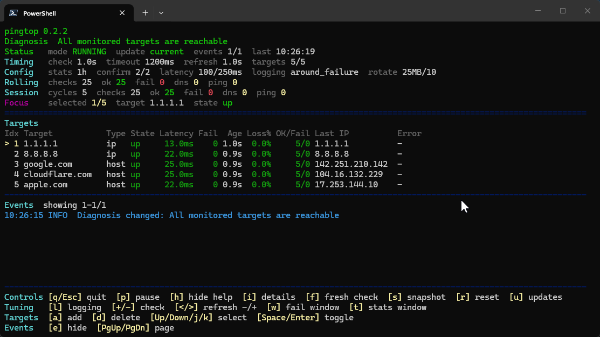

# pingtop

<p>
  <a href="https://github.com/tfindleton/pingtop/actions/workflows/ci.yml"></a>
  <a href="https://github.com/tfindleton/pingtop/blob/main/go.mod"></a>
</p>

<p>
  <a href="https://github.com/tfindleton/pingtop/releases"></a>
  <a href="https://github.com/tfindleton/pingtop/releases"></a>
  <a href="https://github.com/tfindleton/pingtop/releases"></a>
  <a href="https://github.com/tfindleton/pingtop/releases"></a>
</p>

`pingtop` is a terminal network monitor written in Go.



## What It Does

- live terminal UI with redraws, color, and keyboard controls
- concurrent ping and DNS checks with simple failure classification
- cancellable check cycles with live checking, stale, and age indicators
- interactive mode and headless mode
- quiet logging modes, including only state changes or no logging
- single-binary releases for Linux, macOS, and Windows
- ad hoc target runs from the command line without writing CSV logs

Interactive keyboard controls are available on Linux/WSL and Windows. macOS currently runs in headless mode.

## Downloads

Prebuilt binaries are published on [GitHub Releases](https://github.com/tfindleton/pingtop/releases).

- platforms: Linux, macOS, Windows
- architectures: `amd64`, `arm64`, Linux `armv7`
- packaging: single binary per archive, no Go runtime required
- size: release asset sizes vary by platform and version; see the latest release assets for exact download sizes

## Quick Start

Building from source requires Go 1.26.11 or newer. Use the latest patch of a
[supported Go release](https://go.dev/doc/devel/release); the compiler's standard
library is included in the resulting binary.

Run from source:

```bash
go run .           # interactive UI when a supported TTY is available
go run . -n        # headless mode
go run . -o        # single pass
go run . -v        # version
go run . -h        # help
go run . -u        # one-shot update check
go run . --updates
go run . 1.1.1.1
go run . example.com 1.1.1.1
```

Build locally:

```bash
go build -o pingtop
./pingtop
./pingtop -h
./pingtop -v
./pingtop -u
./pingtop --updates
```

Build `pingtop.exe` on Windows:

```powershell
go build -o pingtop.exe .
.\pingtop.exe
.\pingtop.exe -h
.\pingtop.exe -v
.\pingtop.exe -u
.\pingtop.exe --updates
```

Passing one or more positional targets overrides the configured target list for that run only. Those ad hoc runs keep the normal UI or headless behavior, but CSV logging is disabled for that session.

Targets accept IPv4, IPv6, and ASCII hostnames (including local names with
underscores). Use Punycode for international domain names. Invalid hostnames and
terminal control characters are rejected.

To debug update detection without publishing a new release, run:

```bash
pingtop -u
pingtop --updates
pingtop -u --current-version 0.1.3
pingtop --check-updates --current-version 0.1.3 --update-repo https://github.com/tfindleton/pingtop
```

Update repositories must be HTTPS GitHub repository URLs; the
`git@github.com:owner/repo.git` form is also accepted. Update checks stay on the
HTTPS GitHub API, limit response size, and construct release links from the
validated repository and version tag. The `u` key only opens GitHub repository
or release pages.

## Controls

The interactive UI starts with help and events visible and target details hidden by default. It remembers those visibility choices in `pingtop.json`.

The target table's **Fail** column counts all failures for that target since the session started or counters were reset with `r`. Successful checks do not clear it. **Loss%** and **OK/Fail** use the configured rolling stats window (one hour by default), so older results expire from those columns. Small, nonzero loss is shown as `<0.1%`; only zero loss is shown as `0.0%`. Latencies below one millisecond are displayed as `<1ms`.

Press `i` to see details, including the current consecutive failure count and the most recent failure's date, time, and reason. That failure remains available after recovery and rolling-window expiry, even with logging off, and is included in saved snapshots. Pressing `r` clears it with the counters. Counters and last-failure details are kept in memory; restarting the app or deleting and re-adding a target starts fresh history.

Runtime files are written next to the `pingtop` executable: `pingtop.json` for targets and settings, `pingtop_log.csv` for CSV logs, and `pingtop_snapshot_*.txt` for snapshots. When running with `go run`, pingtop uses the launch/current directory instead of Go's temporary build directory.

CSV write errors are reported, with up to 10,000 unsaved rows kept in memory for retry. Queue overflow drops the oldest unsaved rows with a warning. Retries are best effort and partial writes can produce duplicate rows; pending rows do not survive a restart or switching logging off.

The UI shows `off (no CSV)` when logging is off; press `l` to enable it for future checks. Command-line target runs show the selected event-logging mode with `CSV disabled; ad hoc` because those sessions never write CSV files; `l` still changes which in-memory events are recorded. Last-failure details and manual snapshots remain available in either case.

On Windows, the monitor temporarily disables Quick Edit selection and configures
keyboard input explicitly, then restores the previous input mode on exit. Input
is processed in bounded batches so queued console events, held keys, and pasted
text do not delay screen updates with a redraw for every character.

**Controls**
- `q` or `Esc`: quit
- `p`: pause or resume
- `h`: show or hide help
- `i`: show or hide selected-target details
- `e`: show or hide events
- `f`: force a fresh check cycle
- `s`: save a snapshot
- `r`: reset session counters
- `u`: open the release page
- `PgUp` / `PgDn`: page through event history

**Tuning**
- `l`: cycle logging mode (`around_failure`, `changes_only`, `failures_only`, `all`, `off`)
- `+` / `-`: increase or decrease the check interval (`0.50s` to `300.00s`)
- `<` / `>`: decrease or increase the UI refresh interval (`0.10s` to `5.00s`)
- `w`: set the around-failure window
- `t`: set the stats window

**Targets**
- `a`: add a target
- `d`: confirm deleting the selected target
- `D`: delete by target index or exact target
- `Up` / `Down` or `j` / `k`: move the target selector
- `Space` or `Enter`: enable or disable the selected target

## Release Flow

Before tagging a release, update [`internal/pingtop/version.go`](internal/pingtop/version.go) so `Version` matches the tag value without the optional leading `v`.

Then push either tag format:

```bash
git tag 0.1.3
git push origin 0.1.3
```

or:

```bash
git tag v0.1.3
git push origin v0.1.3
```

The release workflow verifies that the tag and source version match, runs tests
and vulnerability checks for every release target, builds release archives, and
attaches them to the GitHub release automatically. Each compiled binary is
scanned before packaging; a failed scan prevents publication.

## Tests

```bash
go test ./...
go test -race ./...
go vet ./...
go mod verify
```

Windows input tests run in an isolated hidden console and cover inherited input
modes, queued events, key repeats, response deadlines, and mode restoration.

## Security Checks

Run the same package-level vulnerability check used by CI:

```bash
go install golang.org/x/vuln/cmd/govulncheck@v1.9.0
govulncheck -scan=package ./...
```

The [security workflow](.github/workflows/security.yml) checks all seven release
OS/architecture combinations on pull requests, pushes to `main`, weekly, and
before releases. Package-level scans also flag advisories in imported packages
whose vulnerable functions may not be called. GitHub Actions are pinned to
commit hashes, and Dependabot checks Go modules and Actions for updates weekly.
Only the release publishing job receives repository write permission.

Keep the minimum patched Go version in `go.mod` current when new security fixes
are published, and update the pinned `govulncheck` version in both workflows and
the command above when upgrading the scanner. To inspect an existing binary:

```bash
govulncheck -mode=binary ./pingtop
```

A clean scan means no known vulnerabilities were reported for the scanned build
and current [Go vulnerability database](https://vuln.go.dev/); it is not a
guarantee against undiscovered vulnerabilities. Existing release binaries must
be rebuilt with the patched toolchain to receive standard-library fixes. The
scanner does not audit the operating system, system `ping`, or browser.
